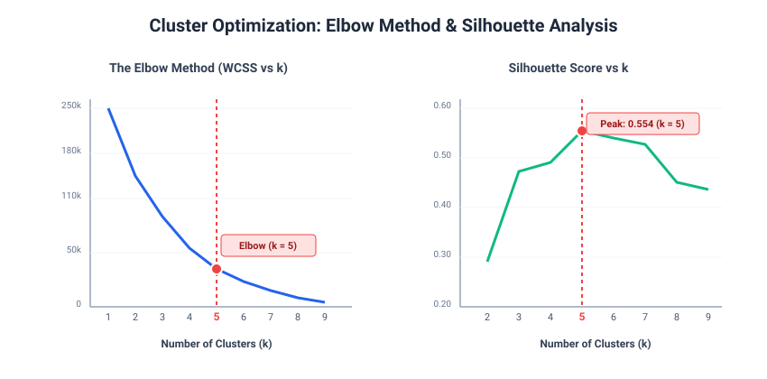
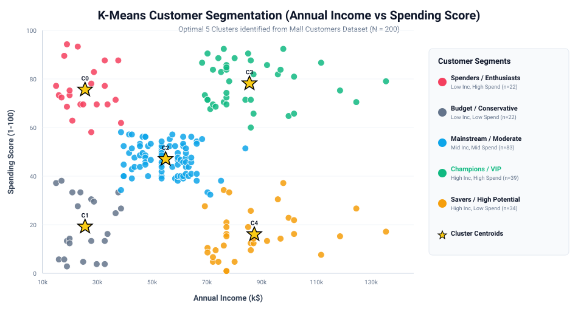
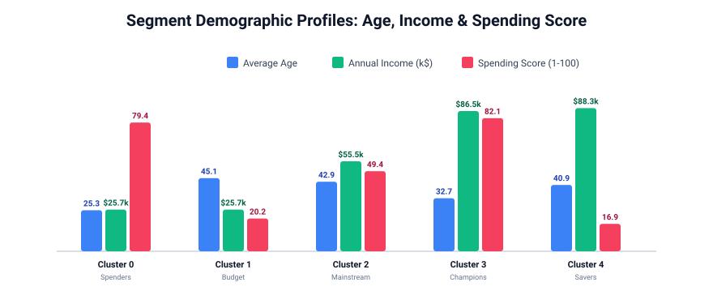
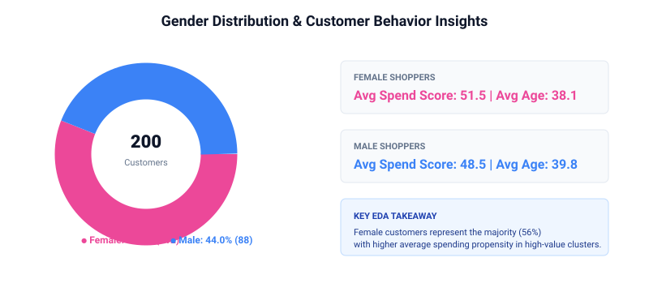

# 🛍️ Customer Segmentation Project

<p align="center">
  
  
  
  
  
  
</p>

---

## 📌 Executive Summary

This project was developed as part of the **Thiranex Data Analytics & Machine Learning Internship** (**Project 2: Customer Segmentation Project**). 

The goal is to segment retail customers based on demographic attributes and purchasing patterns using **Unsupervised Machine Learning (K-Means Clustering and Hierarchical Agglomerative Clustering)**. By identifying distinct behavioral groups, businesses can optimize product placement, tailor promotional campaigns, and maximize customer lifetime value (CLV).

---

## 🎯 Project Objectives & Deliverables

- **Data Ingestion & Preprocessing**: Clean and inspect the Mall Customer dataset (200 records).
- **Exploratory Data Analysis (EDA)**: Uncover demographic distributions and correlation between age, income, and spending score.
- **Cluster Optimization**: Compute **Within-Cluster Sum of Squares (WCSS / Elbow Method)** and **Silhouette Coefficients** to determine the optimal cluster count ($k = 5$).
- **Machine Learning Modeling**: Train **K-Means Clustering** and **Hierarchical Agglomerative Clustering (Ward Linkage)**.
- **Business Persona Profiling**: Define concrete customer archetypes with demographic breakdowns.
- **Strategic Recommendations**: Deliver high-ROI marketing strategies tailored to each cluster.
- **Interactive Web Dashboard**: An interactive, zero-dependency analytics dashboard for stakeholder exploration.

---

## 📊 Dataset Overview

The dataset contains customer demographic and behavioral tracking data:

| Feature | Type | Description |
|---|---|---|
| `CustomerID` | Numerical (ID) | Unique identifier for each shopper |
| `Gender` | Categorical | Biological sex of customer (`Male` / `Female`) |
| `Age` | Numerical | Age of the customer (18 – 70 years) |
| `Annual Income (k$)` | Numerical | Annual earnings in thousands of USD ($15k – $137k) |
| `Spending Score (1-100)` | Numerical | Retail score assigned based on purchase history and spend behavior |

---

## 📈 Visualizations & Methodology

### 1. Cluster Optimization: Elbow Method & Silhouette Analysis
The Elbow Curve identifies a distinct inflection point at **$k = 5$**. In addition, the **Silhouette Analysis** reaches its highest peak at **$k = 5$** with a score of **0.554**, validating tight cluster cohesion and clean separation.



---

### 2. K-Means Customer Clusters (Income vs. Spending Score)
Mapping customers into 2D feature space ($Annual\_Income$ vs $Spending\_Score$) cleanly resolves 5 distinct behavioral segments:



---

### 3. Cluster Demographic Comparison
Cross-segment comparison of average age, income, and spending tendencies reveals strong age-specific and earning-specific purchasing patterns:



---

### 4. Gender & Spending Distribution
Female shoppers represent the majority (56%) of the retail base with slightly higher average spend propensity in high-value categories:



---

## 🧠 Customer Persona Matrix & Strategic Marketing Recommendations

| Cluster | Customer Persona | Size (% of Total) | Avg Age | Avg Income | Avg Spend Score | Targeted Marketing Action Plan |
|:---:|:---|:---:|:---:|:---:|:---:|:---|
| **0** | **Spenders / Enthusiasts** | 22 (11.0%) | 25.3 yrs | $25.7k | **79.4** | **Trendy Fast-Fashion & BNPL**: Target with youthful trend alerts, Buy-Now-Pay-Later installment plans, and social media influencer discount codes. |
| **1** | **Budget / Conservative** | 22 (11.0%) | 45.1 yrs | $25.7k | **20.2** | **Value Packs & Price-Sensitive Deals**: Offer seasonal clearances, bulk-discount coupons, and loyalty cashback rewards for repeat essentials. |
| **2** | **Mainstream / Moderate** | 83 (41.5%) | 42.9 yrs | $55.5k | **49.4** | **Brand Loyalty & Seasonal Promos**: Run family-oriented marketing campaigns, holiday promotional bundles, and standard store loyalty memberships. |
| **3** | **Champions / VIP High Value** | 39 (19.5%) | 32.7 yrs | **$86.5k** | **82.1** | **Luxury Concierge & Exclusive Previews**: High-ROI priority segment! Provide invitation-only product launches, bespoke concierge shopping, and premium rewards. |
| **4** | **Savers / High Potential** | 34 (17.0%) | 40.9 yrs | **$88.3k** | **16.9** | **Premium Durability & Value Proposition**: Educate on investment-grade quality, extended warranties, and high-utility premium products to stimulate expenditure. |

---

## 💻 Interactive Dashboard

The repository includes a responsive HTML5 / Canvas interactive dashboard located at `dashboard/index.html`.

Features:
- Live cluster filtering (view individual segments or all 200 customers).
- Hover tooltips displaying exact customer ID, income, and spending score.
- Dynamic KPI metrics and persona strategy cards.
- Works 100% offline — simply double-click `dashboard/index.html` to open in any web browser.

---

## 📁 Repository Structure

```text
customer-segmentation-project/
├── data/
│   ├── Mall_Customers.csv              # Raw benchmark retail dataset (200 rows)
│   └── segmented_customers.csv         # Enriched dataset with cluster assignments
├── notebooks/
│   └── Customer_Segmentation_Analysis.ipynb  # Interactive Jupyter Notebook
├── dashboard/
│   ├── index.html                      # Interactive web analytics dashboard
│   ├── cluster_summary.json            # Segment aggregate metrics
│   └── customers_points.json           # Geo/scatter coordinates
├── visualizations/
│   ├── 02_gender_and_spending.svg       # Gender demographic breakdown
│   ├── 03_elbow_method_and_silhouette.svg # WCSS Elbow curve & Silhouette scores
│   ├── 04_customer_clusters_scatter.svg # 2D K-Means cluster scatter plot
│   └── 05_cluster_demographic_profiles.svg# Age, Income & Spend comparisons
├── customer_segmentation.py            # Complete end-to-end Python ML pipeline
├── requirements.txt                    # Python library dependencies
├── .gitignore                          # Standard git ignore configuration
└── README.md                           # Comprehensive documentation
```

---

## 🚀 How to Run the Project

### Option A: Direct Python Execution
1. Clone the repository:
   ```bash
   git clone https://github.com/<your-username>/Customer-Segmentation-Project.git
   cd Customer-Segmentation-Project
   ```
2. Install dependencies:
   ```bash
   pip install -r requirements.txt
   ```
3. Run the automated machine learning pipeline:
   ```bash
   python customer_segmentation.py
   ```

### Option B: Interactive Jupyter Notebook
Launch Jupyter Notebook to step through the code and explanations interactively:
```bash
jupyter notebook notebooks/Customer_Segmentation_Analysis.ipynb
```

### Option C: Interactive Dashboard
Simply navigate to the `dashboard/` directory and open `index.html` in Chrome, Edge, or Firefox.

---

## 🛠️ Tech Stack

- **Language**: Python 3.9+
- **Machine Learning**: Scikit-Learn (K-Means, Agglomerative Clustering, DBSCAN, Silhouette Analysis)
- **Data Manipulation**: Pandas, NumPy
- **Data Visualization**: Matplotlib, Seaborn, SVG Canvas
- **Frontend / Dashboard**: HTML5, Modern CSS, Canvas API, JSON

---

## 🎓 Internship Submission Details

- **Platform**: Thiranex Intern Portal (`thiranex.in/student`)
- **Assigned Project**: Project 2 — Customer Segmentation Project
- **Key Focus**: Clustering algorithms, purchase behavior analytics, and segment profiling.
